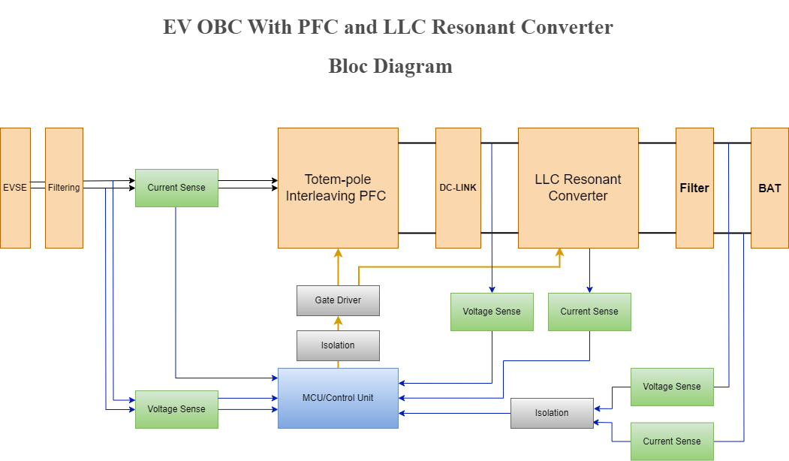

# 7 kW EV On-Board Charger: Totem-Pole PFC + Dual LLC

> [!IMPORTANT]
> The PLECS models use the component libraries in [Gueni/0000_libraries](https://github.com/Gueni/0000_libraries) (`Power`, `Passives`, `Switches`, `Magnatic Components`, `Sensors`, `CTRL`). Get them, and add `0000_libraries/Plecs` to the PLECS library path, before opening or running the models.

Design and simulation of a single-phase EV on-board charger: a totem-pole bridgeless PFC with **average current mode control** feeds a 400 V DC link, and two LLC resonant converters in parallel charge a 250–450 V battery. The PLECS model is built from the library blocks and driven from Python: parameter sweeps, one HTML report with waveforms and harmonics, logs, and optional code generation for a PLECS RT Box. LTspice schematics cover the input filter, the transformer and the LLC stage.



The signal path is **grid → EMI filter → PFC → DC link → dual LLC → DC filter → battery (load)**. Sensors feed an MCU model (ADC + firmware scaling) that runs the PFC controller; the LLC controller sets the switching frequency from the output voltage.

## Specifications

| Parameter | Value |
|---|---|
| Output | 7 kW, 250–450 V DC (nominal 400 V) |
| Input | 230 Vrms, 50 Hz (7 kW needs ≥ 176 Vrms with the 60 A current limit) |
| PFC | totem-pole, 80 kHz fast leg (SiC C3M0021120K), L_boost 98 µH, DC link 1.88 mF / 400 V |
| LLC | 2 × full bridge in parallel, L_r 1.55 µH, C_r 1.2 µF (f_r 116 kHz), L_k 5 µH, 1:1, diode or synchronous rectifier |
| Result, ideal switches, 230 V / 7 kW / 400 V | PF 0.995, grid current THD 1.3 %, DC link 400 V ± 20 V, output 399.8 V |

## Documentation

| Section | Doc |
|---|---|
| Simulation: model, configurations, modes, sweep, results | [doc/simulation.md](doc/simulation.md) |
| LLC stage and LLC controller | [doc/llc.md](doc/llc.md) |
| LTspice schematics | [doc/ltspice.md](doc/ltspice.md) |
| Review: what was fixed and what is still open | [doc/review.md](doc/review.md) |

The PFC power stage, EMI filter, switches, sensors and PFC controller are the library blocks documented in [0049_SP_BTP_PFC_1KW/doc](https://github.com/Gueni/0049_SP_BTP_PFC_1KW/tree/main/doc); this repo scales them to 7 kW.

## Quick start

1. Start PLECS with the XML-RPC server on port 1080 (Preferences → General).
2. Set the parameters in [lib/vars.py](lib/vars.py). In [main.py](main.py), set the sweep and the model depth with `MODE = 'ideal' | 'real'`.
3. Run:

   ```bash
   python main.py        # OBC transient sweep -> data/html/Html_<run>.html
   python analysis.py    # HV DC filter AC sweep -> data/html/AC_<run>.html
   ```

LTspice: open the `.asc` files in [ltspice/](ltspice/) and run them (results are git-ignored).

## Repository layout

```
main.py             entry point: sweep definition, model mode and run flags          [system specific]
analysis.py         AC sweep of the HV DC filter                                     [system specific]
asset/              schematics and screenshots used in the docs
doc/                documentation
model/
  OBC.plecs                 full charger (library blocks + PFC CTRL + LLC CTRL configurations)
  HV_Filter_Analysis.plecs  DC filter, AC sweep 'DC Filter AC Sweep'
  AC_Filter_Analysis.plecs  input filter, stand-alone (init commands)
  Trafo.plecs               LLC transformer, stand-alone (init commands)
lib/
  vars.py           model paths, parameters, configurations, modes                   [system specific]
  calc.py           signal math (PMath) + derived parameters per sweep point (Derived, [system specific])
  plecs.py          PLECS XML-RPC interface, scopes, result folders, sweep points, code generation + RT Box
  process.py        HTML report and result matrices (PPlots), sweep log (PLog)
  signals.py        result column names / units read from the model
  standalone.py     library-free copy of the model (breaklink.py)
ltspice/
  ac_input_filter/  EMI filter variants, AC analysis
  trafo/            transformer model (magnetizing, core loss, leakage)
  llc/              LLC tank, open-loop LLC (diode / synchronous rectifier), 450 W closed-loop LLC
  results/          LTspice outputs (git-ignored)
data/               sweep outputs (git-ignored)
```

`lib/` is the same library as [0049_SP_BTP_PFC_1KW](https://github.com/Gueni/0049_SP_BTP_PFC_1KW): only `vars.py`, `Derived` in `calc.py` and the two entry points are specific to this system.

## Copyright and Licensing

Licensed under the GNU General Public License, Version 3.0. Distributed on an "AS IS" BASIS, WITHOUT WARRANTIES OR CONDITIONS OF ANY KIND.

[Issues](https://github.com/Gueni/OBC/issues) · [Discussions](https://github.com/Gueni/OBC/discussions)
