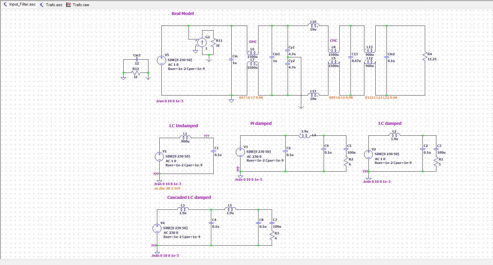
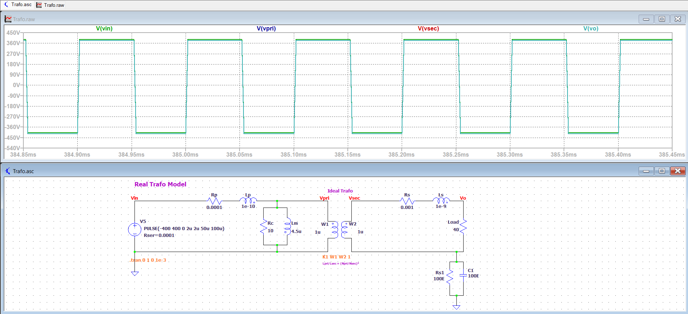

# LTspice schematics

Run them from LTspice (or `LTspice.exe -b <file>.asc`). Outputs (`.raw`, `.log`, `.net` …) are git-ignored.

## `ac_input_filter/Input_Filter.asc`

Five variants of the AC input filter, all in one `.ac dec 20 1 1e9` analysis:

- the real model: Cin → coupled DMC (L6/L7, aiding for differential current) → Cy → CMC (L8/L9) → 0.47 µF → second CMC (L12/L13) → Cin2 → 11.21 Ω load;
- undamped LC;
- damped Pi;
- damped LC;
- cascaded damped LC.

All sources use `AC 1`, so the magnitudes read as transfer functions. Real model: −10.7 dB at 1 kHz, −118 dB at 160 kHz.

## `trafo/Trafo.asc`

The LLC transformer: Lp/Rp → (Lm ∥ Rc) → ideal transformer (W1/W2, K = 1, 10 mH ≫ Lm, Lsec/Lpri = n²) → Rs/Ls → 40 Ω. It is driven with a ±400 V square wave at the LLC resonance (`.param n=1 Vbus=400 fsw=116k`).

The run uses `uic`, and Lm starts at −Vbus/(4·fsw·Lm) so the flux is centred. With these settings:

- ±402 V across the load, 10 A rms in the secondary;
- 16 W of core loss;
- 382 A p-p of magnetizing current. With Lm = 4.5 µH this is the real issue of the current core design, see [review.md](review.md).

The run takes 0.6 s.

## `llc/`

| File | Content | Result |
|---|---|---|
| `LLCTankOnly.asc` | tank (Lr 2 µH, Cr 60 nF, Lm 100 µH), `.ac` with R = 50/100/200 Ω stepped | gain curves |
| `LLCSoftSwitching.asc` | 600 V → 30 V full bridge, 400 kHz, open loop, diode rectifier | Vo = 28.0 V, 112 A |
| `LLCSoftSwitchingSynchRectifier.asc` | same with a synchronous rectifier (AOE66410) | Vo = 29.3 V |
| `LLC_Simulation.asc` | 450 W, 600 V → 30 V closed loop: LTC6990 VCO + type-2 compensator | Vo = 29.55 V, Pin 477 W, Pout 437 W, η = 91.5 % |

These are generic LLC studies (600 V → 30 V), not the OBC stage itself. The OBC LLC is simulated in PLECS ([llc.md](llc.md)).
