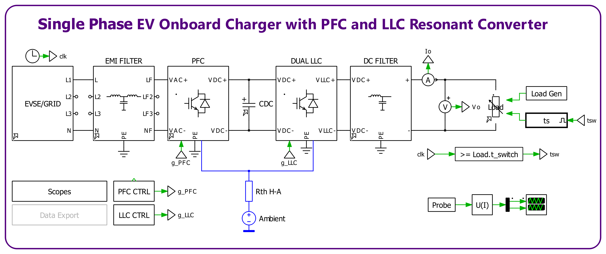

# Simulation, configurations, sweep and results



*(Screenshot of the top level. The model is `model/OBC.plecs`: the same blocks with the load group to the right of `DC FILTER`.)*

## Model

`model/OBC.plecs` is built from the library blocks (`0000_libraries/Plecs`) plus two subsystems of this repo:

| Block | Source | Struct (`vars.py`) | Configuration from |
|---|---|---|---|
| `EVSE/GRID` | `Power` | `Grid` | `Grid.Config` |
| `EMI FILTER` | `Power` | `AC_Filter` | `AC_Filter.Config` (1PH / 3PH / Pass) |
| `PFC` | `Power` | `PFC` | `PFC.Config` (TPB 2 leg / 3 leg / diodes) |
| `A`, `V`, `V2` | `Sensors` | `Sensors.Iin / Vac / Vdc` | – |
| `MCU` → `PFC CTRL` | `CTRL` (inside the MCU subsystem: ADCs + scaling) | `CTRL`, `MCU` | `PFC.Config` |
| `CDC` | `Passives/C` | `DCLink` | `DCLink.Config` |
| `DUAL LLC` | model subsystem, 1 or 2 × `Power/LLC` | `LLC` | `LLC.Stage` (Dual / Single / Pass), inner `LLC.Config` (SR / AR / Pass) |
| `LLC CTRL` | model subsystem (C-Script) | `CTRL` (LLC part) | `CTRL.LLC_Config` (VF PI / fixed frequency) |
| `DC FILTER` | `Power` | `HV_Filter` | `HV_Filter.Config` (Simple / Pi / Pass) |
| `Load` | `Passives/Load` | `Load` | `Load.Config` |
| `Rth H-A`, `Rth LLC` | heatsinks of the PFC and LLC switches | `Thermals` | – |

Every block configuration is a field of `ModelVars`, so the whole model is selected from `vars.py`:

- **PFC only:** `Configs['LLC_Stage'] = 3` (Pass). The load sits on the DC link and its voltage follows `CTRL.Vref`.
- **One LLC:** `Configs['LLC_Stage'] = 2`.

## Settings (`vars.py`)

| Setting | Value |
|---|---|
| `TSIM` | 0.3 s. The PFC is settled after ~75 ms (enable 1 ms + 50 ms soft start). The LLC starts at `CTRL.t_llc_en` = 0.12 s and ramps its output at `CTRL.slew_llc` = 20 V/ms. |
| Load step | at `tSim − load_tflip` = 0.15 s |
| Saved window | `TSAVE = TSIM − 0.05` to the end |
| Solver | variable step, max step 1 ms, rel. tol. 1e-3 |

## Modes

`MODE` in `main.py` sets all block depths at once (`vars.MODES`):

| `MODE` | EMI filter | Capacitors | PFC / LLC switches | Transformer |
|---|---|---|---|---|
| `'ideal'` | Pass | Ideal | Ideal | Ideal |
| `'real'` | on (1PH) | Real | Real (physical equivalent circuit) + warm start | Real (core + gap) |
| `None` | as in `Configs` | | | |

The topology settings (`PFC`, `LLC_Stage`, `LLC`, `LLC_CTRL`, `HV_Filter`, `Load`) keep their `Configs` value in every mode. With the ideal switches, 0.3 s of the full OBC takes about 25 s.

## Running

PLECS must be running with its XML-RPC server on port 1080. Restart PLECS after editing a library, because it caches libraries.

```bash
python main.py
```

`main.py` simulates every combination of the values in `SWEEP`, for example `{'Vin': [230], 'Load.Pout': [7e3], 'Vset': [300, 400, 450]}`. Each key is a parameter name, or the end of its path when the name is used more than once. `Derived.update()` in `calc.py` recomputes the dependent values for each point:

- PFC loop gains;
- load resistance = `Vset² / Pout` (`Vref²` when the LLC stage is Pass);
- switch temperatures;
- window timing.

Results go to `data/`:

| Folder | Contents |
|---|---|
| `timeseries/` | one CSV per point |
| `mat/` | RMS, average, FFT … matrices |
| `traces/` | scope traces |
| `log/` | parameter log |
| `html/` | report |

The other flags (`STANDALONE`, `PARASIM`, `CODEGEN`, `RTBOX` …) work as described in the reference project's [simulation.md](https://github.com/Gueni/0049_SP_BTP_PFC_1KW/blob/main/doc/simulation.md).

`analysis.py` runs the `DC Filter AC Sweep` analysis of `model/HV_Filter_Analysis.plecs` over the `SWEEP` of its DC filter values (`AnalysisOpts['DC_Filter']` = `vars.HV_Filter`).

## Results (ideal switches, 230 V)

| Case | DC link | Grid | Output |
|---|---|---|---|
| PFC only, 7 kW | 399.8 V, 30 V p-p | 30.6 A, PF 0.994, THD 1.4 % | 7.0 kW |
| OBC, dual LLC, Vset 400 V | 404 V, 40 V p-p | 30.7 A, PF 0.995, THD 1.3 % | 399.8 V, 17.5 A, 6.99 kW |
| OBC, Vset 450 V | 407 V | PF 0.995, THD 1.3 % | 449.9 V, 7.0 kW |
| OBC, Vset 300 V | 405 V | PF 0.995 | 303 V (f at `f_max`: lowest reachable output, see [llc.md](llc.md)) |
| OBC, single LLC | 403 V | PF 0.995 | 399.8 V, 7.0 kW |
| OBC, 3.5 kW | 400 V | 16.4 A, PF 0.984, THD 1.5 % | 400.0 V |
| OBC, fixed frequency 116 kHz | 398 V | PF 0.995 | 393 V (open loop) |
